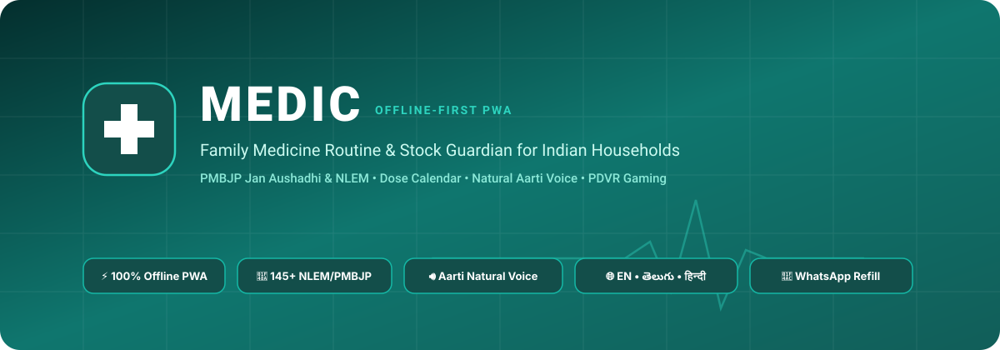
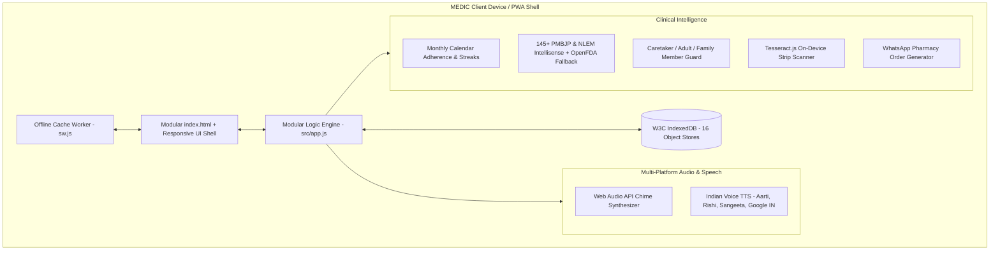

<div align="center">



<br/>

# MEDIC
### Offline-First Family Medicine Routine &amp; Inventory Guardian

[](https://pdvrgaming.github.io/medic/)
[](https://pdvrgaming.github.io/medic/)
[](https://cdsco.gov.in/)
[](#natural-accent-voice-assistance)
[](#zero-cloud-offline-architecture)
[](https://pdvrgaming.github.io/)

<p align="center">
  <strong>A resilient, 100% offline-first Progressive Web Application (PWA) tailored for multi-generational Indian households to track clinical routines, monthly calendar adherence logs, inventory stock depletion, optical packaging recognition, and pharmacy reorders with zero subscription fees, zero cloud surveillance, and authentic natural Indian accent voice guidance.</strong>
</p>

<p align="center">
  <a href="https://pdvrgaming.github.io/medic/"><strong>[ Launch Web Application ]</strong></a> &nbsp;&bull;&nbsp;
  <a href="https://pdvrgaming.github.io/"><strong>[ PDVR Gaming Website ]</strong></a> &nbsp;&bull;&nbsp;
  <a href="#core-capabilities"><strong>[ Core Capabilities ]</strong></a> &nbsp;&bull;&nbsp;
  <a href="#clinical-formulary-database"><strong>[ Medicine Catalogue ]</strong></a> &nbsp;&bull;&nbsp;
  <a href="#system-architecture"><strong>[ Architecture ]</strong></a>
</p>

---

</div>

## Clinical System Overview

<table width="100%">
  <thead>
    <tr>
      <th width="30%" align="left">System Dimension</th>
      <th width="70%" align="left">Clinical &amp; Architectural Specification</th>
    </tr>
  </thead>
  <tbody>
    <tr>
      <td><strong>Live Web Application</strong></td>
      <td><a href="https://pdvrgaming.github.io/medic/">https://pdvrgaming.github.io/medic/</a></td>
    </tr>
    <tr>
      <td><strong>Primary Repository</strong></td>
      <td><a href="https://github.com/pdvrgaming/medic">https://github.com/pdvrgaming/medic</a></td>
    </tr>
    <tr>
      <td><strong>Official Publisher / Firm</strong></td>
      <td><strong><a href="https://pdvrgaming.github.io/">PDVR Gaming</a></strong> (<a href="https://github.com/pdvrgaming">github.com/pdvrgaming</a>)</td>
    </tr>
    <tr>
      <td><strong>Runtime Target</strong></td>
      <td>Modern Web Browsers (Chrome, Edge, Safari, Firefox), Android PWA, iOS PWA</td>
    </tr>
    <tr>
      <td><strong>Storage Engine</strong></td>
      <td>100% Client-Side W3C IndexedDB (16 Atomic Object Stores; Optional Online OpenFDA Fallback)</td>
    </tr>
    <tr>
      <td><strong>Formulary Standards</strong></td>
      <td>145+ Formulations — PMBJP Jan Aushadhi Generics, NLEM 2022, CDSCO &amp; OpenFDA Lookup</td>
    </tr>
    <tr>
      <td><strong>Calendar Adherence Engine</strong></td>
      <td>Monthly Dose Compliance Matrix with Full/Partial/Missed Indicators &amp; Streak Metrics</td>
    </tr>
    <tr>
      <td><strong>Acoustic Synthesizer</strong></td>
      <td>Harmonic Web Audio Tri-Tone Chimes (D5-A5-D6) with Exponential Decay</td>
    </tr>
  </tbody>
</table>

---

## Core Capabilities

<table width="100%">
  <tr>
    <td width="50%" valign="top">
      <h3>⚡ Zero-Cloud Offline Engine</h3>
      <code>STATUS: 100% AIR-GAPPED CAPABLE</code>
      <br/><br/>
      Built strictly to W3C Progressive Web App standards with high-resilience Service Worker caching (<code>sw.js</code>). Runs identically across Android, Apple iOS, Windows, macOS, and Linux desktop browsers. Fully operational in basements, transit, or rural zones with zero cellular connectivity.
    </td>
    <td width="50%" valign="top">
      <h3>💊 Jan Aushadhi &amp; NLEM Formulary</h3>
      <code>STATUS: 145+ FORMULATIONS INCLUDED</code>
      <br/><br/>
      Comprehensive catalogue containing <strong>145+ essential medicine formulations</strong> including <strong>33 Pradhan Mantri Bhartiya Janaushadhi Pariyojana (PMBJP)</strong> generic salts. Features condition-based auto-filtering, two-way generic-to-brand matching, and progressive OpenFDA online lookup with automatic IndexedDB caching.
    </td>
  </tr>
  <tr>
    <td width="50%" valign="top">
      <h3>📅 Calendar Adherence History</h3>
      <code>STATUS: MONTHLY MATRIX &amp; STREAK TRACKING</code>
      <br/><br/>
      Interactive month-by-month compliance calendar visualizing full adherence, partial compliance, and missed doses across English, Telugu, and Hindi. Select any calendar day to inspect itemized logs with patient chips, timestamps, and food timing.
    </td>
    <td width="50%" valign="top">
      <h3>🔊 Natural Accent Speech Synthesis</h3>
      <code>STATUS: EN / HI / TE VOICE CALIBRATED</code>
      <br/><br/>
      Dedicated voice prioritization tuned for natural Indian phonetics. Prioritizes <strong>Microsoft Aarti Online</strong>, <strong>Apple Rishi/Sangeeta/Lekha</strong>, and <strong>Google Indian voices</strong> with calibrated 0.88x cadence and 1.04 pitch for elder clarity in English, తెలుగు, and हिन्दी.
    </td>
  </tr>
  <tr>
    <td width="50%" valign="top">
      <h3>⏰ Harmonic Web Audio Chimes</h3>
      <code>STATUS: D5 - A5 - D6 RESONANCE</code>
      <br/><br/>
      Zero-file Web Audio API algorithmic chime generator. Synthesizes gentle tri-tone acoustic alerts (587 Hz &rarr; 880 Hz &rarr; 1175 Hz) with exponential decay ramps, checked continuously every 15 seconds for due schedules.
    </td>
    <td width="50%" valign="top">
      <h3>💬 WhatsApp Pharmacy Refill Dispatcher</h3>
      <code>STATUS: 1-TAP STANDARDIZED ORDER</code>
      <br/><br/>
      Compiles low stock warnings and monthly prescriptions into clean, standardized WhatsApp refill orders formatted for immediate sending to neighborhood chemists without manual typing.
    </td>
  </tr>
  <tr>
    <td width="50%" valign="top">
      <h3>📷 On-Device Packaging OCR Engine</h3>
      <code>STATUS: CLIENT-SIDE TESSERACT.JS</code>
      <br/><br/>
      HTML5 Canvas pre-processing normalizes contrast and applies adaptive thresholding before client-side Tesseract.js extracts brand names, strengths, and manufacturers locally without uploading packaging photos.
    </td>
    <td width="50%" valign="top">
      <h3>👓 Accessibility &amp; Role Control (RBAC)</h3>
      <code>STATUS: 15px / 17px / 19px REFLOW</code>
      <br/><br/>
      Anti-clutter responsive font scaling (Normal 15px, Large 17px, Extra-Large 19px) paired with multi-role access control (Caretaker, Adult Member, Family Member View-Only) enforced at both UI and IndexedDB layers.
    </td>
  </tr>
</table>

---

## Multi-Role Access Control (RBAC)

<table width="100%">
  <thead>
    <tr>
      <th width="33%" align="center">CARETAKER MODE</th>
      <th width="33%" align="center">ADULT MEMBER MODE</th>
      <th width="34%" align="center">FAMILY MEMBER (VIEW)</th>
    </tr>
  </thead>
  <tbody>
    <tr>
      <td valign="top">
        <strong>Administrative Control</strong>
        <ul>
          <li>Prescribe medicine regimens</li>
          <li>Register &amp; manage household members</li>
          <li>Scan blister packaging via OCR</li>
          <li>Record pharmacy purchases</li>
          <li>Manage full 16-store backups &amp; safe wipe</li>
        </ul>
      </td>
      <td valign="top">
        <strong>Operational Execution</strong>
        <ul>
          <li>Log taken and skipped doses</li>
          <li>Track daily routines &amp; calendar history</li>
          <li>Record expense purchases</li>
          <li>Inspect current stock inventory</li>
          <li>Trigger WhatsApp pharmacy reorders</li>
        </ul>
      </td>
      <td valign="top">
        <strong>Accessible Senior Mode</strong>
        <ul>
          <li>Clean, distraction-free routine view</li>
          <li>One-tap dose confirmation</li>
          <li>Aarti natural voice read-aloud</li>
          <li>Extra-Large anti-clutter font scaling</li>
          <li>Admin &amp; destructive settings locked</li>
        </ul>
      </td>
    </tr>
  </tbody>
</table>

---

## Clinical Formulary Database

<details open>
<summary><strong>PMBJP Jan Aushadhi &amp; NLEM 2022 Classification Reference (145+ Formulations)</strong></summary>
<br/>

<table width="100%">
  <thead>
    <tr>
      <th width="25%" align="left">Clinical Classification</th>
      <th width="35%" align="left">Reference Formulations</th>
      <th width="20%" align="left">Standard Food Timing</th>
      <th width="20%" align="left">Regulatory Standard</th>
    </tr>
  </thead>
  <tbody>
    <tr>
      <td><strong>Jan Aushadhi Generics</strong></td>
      <td>Metformin IP 500/1000mg, Telmisartan IP 40mg, Paracetamol IP 650mg, Atorvastatin IP 10/20mg, Pantoprazole IP 40mg</td>
      <td>Clinical Protocol</td>
      <td>PMBJP / NLEM</td>
    </tr>
    <tr>
      <td><strong>Cardiology &amp; BP</strong></td>
      <td>Telma 40, Telma AM, Amlopres 5, Cilacar 10, Ciplar, Losar</td>
      <td>After Food</td>
      <td>CDSCO / NLEM 2022</td>
    </tr>
    <tr>
      <td><strong>Endocrinology (Diabetes)</strong></td>
      <td>Glycomet 500, Glycomet-GP 1/2, Januvia 100, Galvus Met, Forxiga</td>
      <td>Before / With Food</td>
      <td>NLEM 2022</td>
    </tr>
    <tr>
      <td><strong>Gastroenterology</strong></td>
      <td>Pan 40, Pan-D, Omez 20, Razo 20, Pantocid 40, Gelusil</td>
      <td>Before Food (Empty Stomach)</td>
      <td>NLEM 2022</td>
    </tr>
    <tr>
      <td><strong>Analgesics &amp; Fever</strong></td>
      <td>Dolo 650, Calpol 500/650, Combiflam, Zerodol-P/SP</td>
      <td>After Food</td>
      <td>CDSCO / NLEM 2022</td>
    </tr>
    <tr>
      <td><strong>Thyroid Care</strong></td>
      <td>Thyronorm 25/50/75/100 mcg, Eltroxin, Thyrox</td>
      <td>Early Morning (Empty Stomach)</td>
      <td>CDSCO</td>
    </tr>
    <tr>
      <td><strong>Respiratory &amp; Asthma</strong></td>
      <td>Asthalin 100 mcg Inhaler, Budecort, Foracort, Montair LC</td>
      <td>Anytime / Night</td>
      <td>NLEM 2022</td>
    </tr>
    <tr>
      <td><strong>Vitamins &amp; Supplements</strong></td>
      <td>Becosules Z, Neurobion Forte, Shelcal 500, Evion 400, Uprise-D3</td>
      <td>After Food</td>
      <td>CDSCO</td>
    </tr>
    <tr>
      <td><strong>Antibiotics &amp; Infections</strong></td>
      <td>Augmentin 625 Duo, Azithral 500, Taxim-O 200, Cifran 500</td>
      <td>After Food</td>
      <td>CDSCO / NLEM 2022</td>
    </tr>
  </tbody>
</table>

</details>

---

## System Architecture



---

## 📱 PWA Installation Guide

- **Android (Chrome / Samsung Internet):** Open [https://pdvrgaming.github.io/medic/](https://pdvrgaming.github.io/medic/) and tap **Install** on the floating prompt, or go to **Settings $\rightarrow$ Install App on Device**.
- **Apple iOS (iPhone / iPad Safari):** Tap the **Share icon (⎋)** $\rightarrow$ **"Add to Home Screen" (＋)** $\rightarrow$ **Add**.
- **Desktop (Windows / macOS / Linux):** Click the **Install icon (⊕)** in the browser address bar to launch in standalone desktop mode.

---

## 💻 Local Development

```bash
git clone https://github.com/pdvrgaming/medic.git
cd medic
npx serve .
# or: python -m http.server 8000
```

Open `http://localhost:3000` (or `8000`) in any modern browser.

---

## License

Copyright &copy; 2026 **[PDVR Gaming](https://pdvrgaming.github.io/)**. Distributed under the **MIT License**.

<div align="center">
  <sub>A Privacy-First Household Health Initiative by <a href="https://pdvrgaming.github.io/">PDVR Gaming</a>.</sub>
</div>
